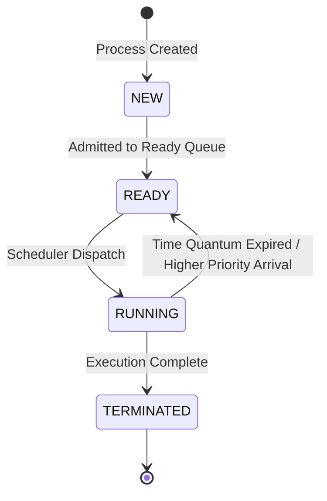
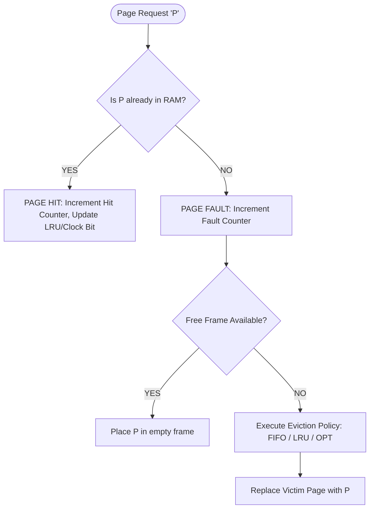
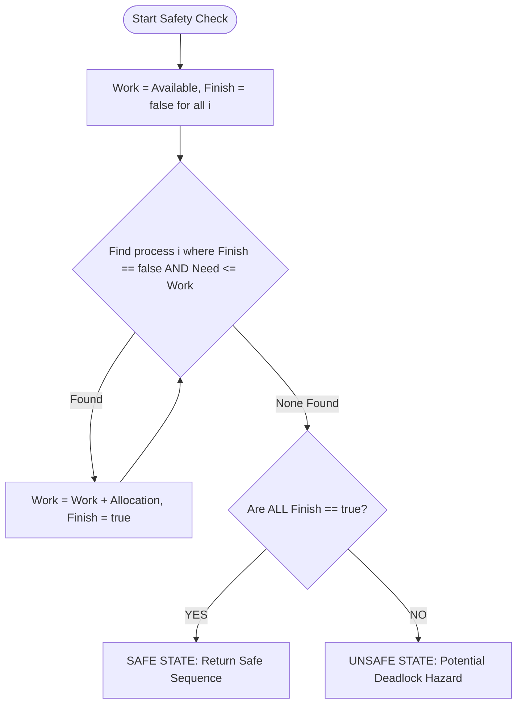

# 📘 Operating System Learning Suite — Comprehensive Technical Specification & Deep Dive

---

## 📑 Table of Contents
1. [Executive Summary & Motivation](#1-executive-summary--motivation)
2. [High-Level Design (HLD)](#2-high-level-design-hld)
3. [Low-Level Design (LLD)](#3-low-level-design-lld)
4. [Subsystem Deep Dives & Mathematical Foundations](#4-subsystem-deep-dives--mathematical-foundations)
   - [4.1 CPU Scheduling Subsystem](#41-cpu-scheduling-subsystem)
   - [4.2 Virtual Memory & Page Replacement Subsystem](#42-virtual-memory--page-replacement-subsystem)
   - [4.3 Deadlock Avoidance Subsystem (Banker's Algorithm)](#43-deadlock-avoidance-subsystem-bankers-algorithm)
   - [4.4 Disk Scheduling Subsystem](#44-disk-scheduling-subsystem)
5. [Engineering Challenges, Pitfalls & Solutions](#5-engineering-challenges-pitfalls--solutions)
6. [Senior Software Engineer / FAANG Mock Interview](#6-senior-software-engineer--faang-mock-interview)

---

## 1. Executive Summary & Motivation

The **Operating System Learning Suite** is a dual-core educational platform designed to bridge abstract theoretical concepts taught in Computer Science curricula with concrete, interactive, deterministic execution models. 

### Why this project was built:
Standard textbook learning for OS principles often suffers from two disconnects:
1. **The Static Disconnect:** Gantt charts, page frame tables, and deadlock matrices are typically presented as frozen diagrams in textbooks (e.g., Silberschatz, Galvin, Gagne), preventing students from observing dynamic phenomena such as the **Convoy Effect**, **Priority Inversion**, **Starvation via SSTF**, or **Belady’s Anomaly**.
2. **The Implementation Disconnect:** Students rarely inspect how an actual OS scheduling queue or memory manager is implemented in systems code ($C++$) versus how it can be reactive and visual ($JavaScript/React$).

### Key Capabilities:
- **Client-Side Reactive Web Dashboard:** Built with React 18, Vite, and Tailwind CSS. Runs client-side with zero server latency, generating step-by-step Gantt charts, memory access trace logs, and comparative algorithm benchmarks.
- **Native $C++17$ Core Engine:** A zero-dependency, cache-conscious simulation core implementing the exact same algorithms in idiomatic C++, printing tabular metrics, Gantt timelines, and verification data.
- **Production Edge Deployment:** Hosted globally on Vercel with automated CI/CD directly synced from GitHub.

---

## 2. High-Level Design (HLD)

### 2.1 System Architecture

```mermaid
flowchart TD
    subgraph Browser ["Web Client (Browser)"]
        UI["React 18 UI Layer (Tailwind CSS + Framer Motion)"]
        State["Reactive State Store (useState / useMemo)"]
        SimEngine["In-Browser Simulation Engine (Pure JS)"]
        TraceLogger["Deterministic Execution Trace Logger"]
    end

    subgraph Native ["Host Machine (Terminal / Native)"]
        CPP["C++17 Engine (main.cpp)"]
        Binary["Compiled Binary (./scheduler)"]
    end

    subgraph Cloud ["Cloud Infrastructure (Vercel + GitHub)"]
        Repo["GitHub Repo (mishraa-G/os-learning-suite)"]
        VercelCDN["Vercel Global Edge Network (CDN)"]
    end

    UI <--> State
    State --> SimEngine
    SimEngine --> TraceLogger
    TraceLogger --> UI

    CPP --> Binary
    Repo -->|Automated Webhook| VercelCDN
    VercelCDN -->|Serves Static Assets (HTML/CSS/JS)| Browser
```

### 2.2 Component Hierarchy & Responsibilities

```
App.jsx (Root Layout, Top Navbar, Tab Routing)
 ├── Navbar.jsx (Module Selection, Theme Styling)
 ├── CpuScheduler.jsx (6 CPU Algorithms, Gantt Chart, Pre-emption Engine)
 ├── MemoryPaging.jsx (4 Paging Algos, Belady's Anomaly Tester, RAM Frame Matrix)
 ├── BankersDeadlock.jsx (Safety Algorithm, Need Matrix, Request Validator)
 ├── DiskScheduler.jsx (4 Disk Algos, Canvas Head Sweep Visualizer)
 ├── Benchmarks.jsx (Comparative Performance Matrix Across All Algos)
 └── StudentCheatsheet.jsx (Interactive Flashcards & Interview Review)
```

---

## 3. Low-Level Design (LLD)

### 3.1 Data Structures & Memory Layouts

#### A. CPU Scheduling Core (`main.cpp` & `CpuScheduler.jsx`)
```cpp
struct Process {
    int pid;             // Unique identifier
    int arrivalTime;     // Timestamp process enters ready queue
    int burstTime;       // Total CPU time required
    int remainingTime;   // Decremented each CPU tick (preemptive algorithms)
    int priority;        // Lower integer = Higher priority (standard UNIX convention)
    int startTime = -1;  // First instant CPU touched this process
    int completionTime;  // Timestamp process transitions to TERMINATED
    int waitingTime;     // TAT - BurstTime
    int turnaroundTime;  // CompletionTime - ArrivalTime
    int responseTime;    // StartTime - ArrivalTime
    bool starved = false;// Dynamic aging flag
};

struct GanttEntry {
    int start;
    int end;
    std::string label;  // e.g., "P1", "P2", "IDLE"
    int pid;
};
```

#### B. Virtual Memory Frame Representation
```
Physical Frames = Array<Frame>[FrameCount]
Page Reference String = [1, 2, 3, 4, 1, 2, 5, 1, 2, 3, 4, 5]
Lookup Structure = Set<int> (O(1) hit validation)
History Buffer = Array<{ step: int, page: int, frames: int[], isHit: boolean, evicted: int }>
```

#### C. Banker's Algorithm Matrix Space
```
Available Vector:  A[m]           (m = Resource Types)
Max Matrix:        M[n][m]        (n = Processes)
Allocation Matrix: C[n][m]
Need Matrix:       N[n][m] = M[n][m] - C[n][m]
Work Vector:       W[m] = Copy(A)
Finish Vector:     F[n] = Array<bool>(false)
```

---

## 4. Subsystem Deep Dives & Mathematical Foundations

### 4.1 CPU Scheduling Subsystem



#### Algorithms Implemented:
1. **First-Come, First-Served (FCFS):**
   - Non-preemptive.
   - Susceptible to the **Convoy Effect**: a long CPU-bound process blocks all subsequent short I/O-bound processes.
2. **Shortest Job First (SJF):**
   - Non-preemptive.
   - Provably minimizes Average Waiting Time among non-preemptive algorithms, but requires prior knowledge of burst times.
3. **Shortest Remaining Time First (SRTF):**
   - Preemptive variant of SJF.
   - Evaluates remaining burst time on every clock tick or process arrival.
4. **Round Robin (RR):**
   - Preemptive with configurable Time Quantum $q$.
   - Prevents starvation. If $q \to \infty$, RR degrades to FCFS. If $q \to 0$, context switch overhead dominates.
5. **Priority Scheduling with Dynamic Aging:**
   - Preemptive / Non-preemptive.
   - Suffers from starvation under heavy load.
   - **Aging Solution:** For every $T_{age}$ cycles a process spends unserviced in the ready queue, its effective priority integer decrements by 1.
6. **Multilevel Feedback Queue (MLFQ):**
   - Implements 3 priority tiers:
     - **Queue 0 (High):** Round Robin ($q = 2$). Fast response for I/O-bound jobs.
     - **Queue 1 (Medium):** Round Robin ($q = 4$). Intermediate compute.
     - **Queue 2 (Low):** FCFS. Long batch compute processes.
   - CPU-bound tasks that exhaust their quantum get demoted down the ladder.

#### Governing Mathematical Formulas:
$$\text{Turnaround Time } (TAT_i) = CT_i - AT_i$$
$$\text{Waiting Time } (WT_i) = TAT_i - BT_i$$
$$\text{Response Time } (RT_i) = ST_i - AT_i$$
$$\text{CPU Utilization } = \frac{\sum BT_i}{\max(CT) - \min(AT)} \times 100\%$$
$$\text{Throughput} = \frac{N}{\max(CT) - \min(AT)}$$

---

### 4.2 Virtual Memory & Page Replacement Subsystem



#### Algorithms Implemented:
1. **FIFO (First-In, First-Out):** Evicts the oldest loaded page.
2. **LRU (Least Recently Used):** Evicts the page whose last reference timestamp is smallest.
3. **Optimal (OPT / MIN):** Evicts the page that will not be used for the longest period in the future.
4. **Clock (Second-Chance):** Circular list with reference bits approximating LRU without true timestamp overhead.

#### Belady's Anomaly Deep Dive:
Generally, increasing physical memory frames should decrease or keep constant the number of page faults. In **FIFO**, however, increasing frames can *increase* page faults!

**Concrete Anomaly Trace (`1, 2, 3, 4, 1, 2, 5, 1, 2, 3, 4, 5`):**
- With **3 Frames**: Result = **9 Page Faults**
- With **4 Frames**: Result = **10 Page Faults**

```
Frame Count = 3 (FIFO)
Ref:    1  2  3  4  1  2  5  1  2  3  4  5
F0:     1  1  1  4  4  4  5  5  5  5  5  5
F1:        2  2  2  1  1  1  1  1  3  3  3
F2:           3  3  3  2  2  2  2  2  4  4
Hit/F:  F  F  F  F  F  F  F  H  H  F  F  H  => Total Faults = 9

Frame Count = 4 (FIFO)
Ref:    1  2  3  4  1  2  5  1  2  3  4  5
F0:     1  1  1  1  1  1  5  5  5  5  4  4
F1:        2  2  2  2  2  2  1  1  1  1  5
F2:           3  3  3  3  3  3  2  2  2  2
F3:              4  4  4  4  4  4  3  3  3
Hit/F:  F  F  F  F  H  H  F  F  F  F  F  F  => Total Faults = 10 (Anomaly!)
```

**Why Stack Algorithms (LRU, OPT) are Immune:**
A replacement algorithm is a **Stack Algorithm** if the set of pages in memory for $n$ frames at time $t$ is always a subset of the pages in memory for $n+1$ frames:
$$S(n, t) \subseteq S(n+1, t)$$
Because FIFO does not satisfy this subset inclusion property, it is prone to Belady's Anomaly.

---

### 4.3 Deadlock Avoidance Subsystem (Banker's Algorithm)



#### The 4 Necessary Coffman Conditions for Deadlock:
1. **Mutual Exclusion:** At least one resource is held in a non-shareable mode.
2. **Hold and Wait:** A process holds at least one resource and is waiting for others.
3. **No Preemption:** Resources cannot be forcibly seized; only released voluntarily.
4. **Circular Wait:** A closed cycle exists where $P_0$ waits for $P_1$, $P_1$ waits for $P_2$, $\dots$, $P_k$ waits for $P_0$.

**Banker's Algorithm** avoids deadlock dynamically by refusing to transition the system into an **Unsafe State** (a state from which there is no guarantee that all processes can finish without deadlock).

---

### 4.4 Disk Scheduling Subsystem

#### Algorithms Implemented:
1. **FCFS:** Traverses requests in arrival order. Severe head movement swings.
2. **SSTF (Shortest Seek Time First):** Greedy algorithm choosing $\min |Req_j - CurrentHead|$. Can cause starvation on tracks at disk edges.
3. **SCAN (Elevator Algorithm):** Sweeps in one direction to the disk boundary (e.g. cylinder 199), then reverses.
4. **C-SCAN (Circular SCAN):** Sweeps in one direction to the boundary, then immediately returns to track 0 without servicing requests on the return sweep.

**Why C-SCAN is Superior to SCAN:**
Under heavy random load, tracks near the boundary are visited once per round trip in SCAN, while tracks in the center are visited twice. C-SCAN eliminates this bias, providing a **uniform waiting distribution** across all cylinders.

---

## 5. Engineering Challenges, Pitfalls & Solutions

| # | Challenge Encountered | Technical Root Cause | Engineering Solution Implemented |
| :--- | :--- | :--- | :--- |
| **1** | Real-time Gantt Chart recalculation lag | Recomputing full simulation on every keystroke in process table inputs | Wrapped computational core in `useMemo`, decoupling pure calculation from DOM renders and debounce-protecting numeric inputs. |
| **2** | Starvation in Priority & SRTF | Lower-priority processes with high burst times never received CPU time under steady arrival | Implemented **Dynamic Aging** where unserviced processes gain priority every $T$ cycles, and added dedicated presets demonstrating starvation before and after aging. |
| **3** | Visualizing IDLE CPU intervals | When process arrivals have gaps ($AT_2 > CT_1$), Gantt rendering collapsed the gap | Integrated synthetic `IDLE` blocks with explicit start/end markers into the timeline to preserve temporal integrity. |
| **4** | Cross-platform C++ compilation | Discrepancies between GCC, Clang (macOS), and MSVC | Wrote strictly conforming ISO $C++17$ code using only standard STL containers (`<vector>`, `<queue>`, `<unordered_map>`) with zero external libraries. |
| **5** | Vercel Deployment Name Rejection | Directory was named `OS` (uppercase), which violates Vercel project name specs (`[a-z0-9._-]`) | Configured the deployment explicitly with `--name os-learning-suite`, added a production build verification step, and connected GitHub CI/CD webhooks. |

---

## 6. Senior Software Engineer / FAANG Mock Interview

### 💼 Module 1: CPU Scheduling & Kernel Internals

#### Q1: "Explain the tradeoff between CPU Scheduling latency and throughput. Why doesn't Linux just use Round Robin with a tiny time quantum like 0.1ms?"
> **Senior Interviewer Answer:**
> "A scheduling quantum determines the balance between interactive responsiveness and computational throughput. 
> Every time the CPU switches from one task to another, a **Context Switch** occurs:
> 1. Registers ($RIP$, $RSP$, general-purpose registers) must be saved into the Process Control Block ($PCB$) / Kernel Stack.
> 2. The kernel switches address spaces by updating the Page Table Base Register (CR3 on x86-64), which **flushes the TLB (Translation Lookaside Buffer)** unless PCID (Process Context Identifiers) are enabled.
> 3. CPU instruction/data L1/L2 caches become cold, causing cache misses.
>
> If quantum $q = 0.1\text{ms}$ and context switch overhead $C = 10\mu\text{s}$, the system wastes nearly $10\%$ of total CPU capacity purely in kernel dispatch overhead. Linux CFS (Completely Fair Scheduler) uses a dynamic target latency (e.g. `sysctl_sched_latency`) and calculates process time slices based on `vruntime` (virtual runtime) weighted by nice values, guaranteeing a minimum granularity (`sched_min_granularity_ns`) to prevent context switch thrashing."

---

#### Q2: "How does Linux CFS (Completely Fair Scheduler) fundamentally differ from the discrete multi-queue algorithms in this suite?"
> **Senior Interviewer Answer:**
> "The discrete algorithms in our suite (FCFS, SJF, RR, MLFQ) divide time into fixed discrete ticks or integer queues. 
> Linux CFS models an 'ideal multi-tasking CPU' where $N$ processes execute simultaneously at $1/N$ speed. 
> CFS tracks `vruntime` for each task:
> $$vruntime += \Delta \text{exec\_time} \times \frac{\text{NICE\_0\_LOAD}}{\text{task\_weight}}$$
> Instead of discrete queues, CFS stores runnable tasks in a **time-ordered Red-Black Tree ($O(\log N)$)** or augmented binary tree. The scheduler always selects the leftmost node ($\min(vruntime)$). When a task runs, its $vruntime$ increases, causing it to drift rightward in the tree. This eliminates arbitrary quantum choices and provides continuous fairness."

---

### 💾 Module 2: Memory Hierarchy & Virtual Memory

#### Q3: "What is the Three-Level Page Table walking latency? If memory access is 50ns and TLB lookup is 2ns, what is the Effective Memory Access Time (EMAT) with a 98% TLB hit rate?"
> **Senior Interviewer Answer:**
> "On a multi-level page table without a TLB hit, the MMU must walk each table level sequentially in physical memory before reaching the actual data.
> - With a **3-Level Page Table**:
>   - TLB Hit: $T_{hit} = T_{TLB} + T_{RAM} = 2\text{ns} + 50\text{ns} = 52\text{ns}$
>   - TLB Miss: $T_{miss} = T_{TLB} + (3 \times T_{RAM}) + T_{RAM} = 2 + 150 + 50 = 202\text{ns}$
> - Effective Memory Access Time:
>   $$EMAT = (\text{HitRate} \times T_{hit}) + ((1 - \text{HitRate}) \times T_{miss})$$
>   $$EMAT = (0.98 \times 52\text{ns}) + (0.02 \times 202\text{ns}) = 50.96 + 4.04 = 55\text{ns}$$
> This demonstrates why hardware TLB hit rates ($>95\%$) are vital for systems performance."

---

#### Q4: "Why can't true Optimal Page Replacement (MIN) be implemented in a real operating system kernel? How do modern OSes approximate it?"
> **Senior Interviewer Answer:**
> "The Optimal algorithm requires clairvoyant knowledge of the future page access sequence ($\mathcal{O}(1)$ oracle), which is impossible for non-deterministic user processes.
> 
> Furthermore, even true **LRU** is too costly for hardware MMUs: maintaining a sorted linked list or timestamp update on every single memory reference would stall memory bus bandwidth.
> 
> Modern kernels use **approximations**:
> 1. **Clock / Second-Chance Algorithm:** Uses a single hardware-managed `Accessed/Referenced` bit in the Page Table Entry (PTE).
> 2. **Two-Handed Clock Algorithm (BSD/Solaris):** One hand clears referenced bits, while the second hand checks for pages that remained unreferenced between passes.
> 3. **Active/Inactive Lists (Linux Page Cache):** Pages enter the inactive list and must be referenced twice to migrate to the active list, filtering out single-scan streaming data."

---

### 🔒 Module 3: Concurrency, Synchronization & Deadlocks

#### Q5: "In Banker's Algorithm, why is an 'Unsafe State' not strictly synonymous with a 'Deadlock'?"
> **Senior Interviewer Answer:**
> "An **Unsafe State** means that the system cannot guarantee that all processes will finish if every process simultaneously requests its declared maximum resource allocation. 
> 
> However:
> - Deadlock requires all 4 Coffman conditions to hold simultaneously, including actual blocking on a cycle.
> - If processes do not immediately request their maximum resources and instead terminate or yield early, the system can transit through an unsafe state without ever deadlocking.
> 
> Thus:
> $$\text{Deadlock States} \subset \text{Unsafe States}$$
> Banker's Algorithm is conservative: it trades resource concurrency for absolute safety."

---

#### Q6: "How do modern production operating systems handle deadlock? Why don't Linux, Windows, or macOS run Banker's Algorithm?"
> **Senior Interviewer Answer:**
> "Production general-purpose OSes use the **Ostrich Algorithm** (ignoring the problem or relying on userland timeouts):
> 1. **Lack of A Priori Information:** User processes cannot predict their maximum resource requirements ($MaxMat$) ahead of time.
> 2. **Dynamic Process Churn:** Processes and threads constantly spawn and exit; maintaining $O(m \cdot n^2)$ safety checks on every `malloc()` or `pthread_mutex_lock()` would cripple throughput.
> 3. **Alternative Prevention:** Modern kernels use **Lock Ordering Protocols** (e.g. Linux `lockdep` static validator enforces acquiring lock $A$ before lock $B$ everywhere to eliminate Circular Wait) or Lock Timeouts (`pthread_mutex_timedlock`)."

---

### 💿 Module 4: I/O Subsystems & Disk Scheduling

#### Q7: "Do SSDs and NVMe drives still need SCAN or SSTF disk scheduling? Why or why not?"
> **Senior Interviewer Answer:**
> "No. Traditional disk scheduling algorithms (SSTF, SCAN, C-SCAN) were specifically engineered to minimize physical mechanical movement:
> - **Seek Time:** Moving the mechanical read/write head actuator across physical concentric cylinders.
> - **Rotational Latency:** Waiting for the disk platter to spin to the target sector.
>
> In **SSDs/NVMe flash storage**:
> 1. There are no moving heads or rotational platters; random access latency is uniform ($\sim 10\text{--}100\mu\text{s}$).
> 2. NVMe controllers utilize deep hardware queues (up to 64,000 queues with 64,000 commands each) with parallel NAND channel controllers.
> 3. Modern Linux kernels use **None / Kyber / BFQ (Budget Fair Queueing)** for NVMe, focusing on QoS, throughput throttling, and write wear leveling rather than cylinder geometry."

---

## 7. Verification & Self-Test Checklist for Candidates

- [x] Explain the Convoy Effect and reproduce it in under 30 seconds using the web UI presets.
- [x] Derive why Belady's Anomaly occurs on `1, 2, 3, 4, 1, 2, 5, 1, 2, 3, 4, 5` for FIFO but never for LRU.
- [x] Walk through the $O(m \cdot n^2)$ verification of the Safe Sequence in Banker's algorithm on a whiteboard.
- [x] Compare context switch overhead tradeoffs between cooperative vs preemptive multi-tasking.
- [x] Articulate how Linux CFS replaces fixed time quanta with virtual runtime ($vruntime$) and red-black trees.
- [x] Discuss why rotational disk scheduling algorithms are bypassed in modern NVMe architectures.
